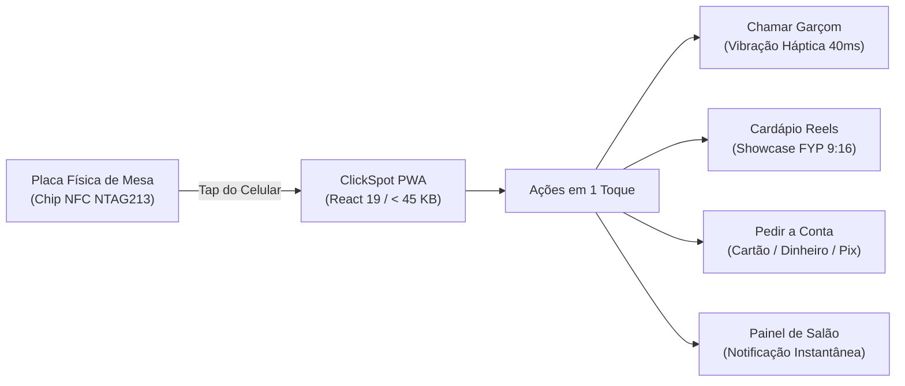

# 🛎️ ClickSpot — Atendimento Inteligente de Mesas com NFC & PWA Ultraleve

[](https://react.dev)
[](https://www.typescriptlang.org)
[](https://vitejs.dev)
[](https://vitest.dev)
[]()
[]()
[](LICENSE)
[]()

> **Encostou. Chamou. Pediu.**  
> Solução integrada de hardware físico (NFC NTAG213/215 + QR Code) e software ultraleve (< 45 KB) para atendimento instantâneo em restaurantes, bares e cafeterias, sem downloads de lojas ou cadastros.

---

## ⚡ Quickstart

```bash
# 1. Clonar o repositório
git clone https://github.com/kazuhirokamim/clickspot.git
cd clickspot

# 2. Instalar dependências
npm install

# 3. Rodar suíte de testes (30 testes TDD verdes)
npm test

# 4. Iniciar servidor de desenvolvimento
npm run dev
```

Acesse em seu navegador móvel em `http://localhost:5173`.

---

## 🏛️ Fluxo Operacional Ciberfísico



---

## 🚀 Diferenciais de Engenharia

- **Zero Instalação & Zero Cadastro:** O cliente não baixa aplicativos da App Store/Google Play nem cria senhas. A URL é disparada instantaneamente via chip NFC.
- **Showcase FYP 9:16:** Feed vertical de vídeos curtos dos pratos para elevar o ticket médio e o apetite do consumidor.
- **Feedback Háptico Imediato:** Confirmação de chamada de mesa via `navigator.vibrate` com fallback inteligente para dispositivos sem suporte.
- **Privacy by Design:** Nenhum dado pessoal do cliente é coletado ou armazenado (100% LGPD compliant).
- **Test-First Rigor:** 30 testes unitários automatizados com Vitest cobrindo fluxos de chamada, navegação de mídia e multi-inquilino.

---

## 📁 Estrutura de Diretórios

```
clickspot/
├── docs/                           # Planos SDD 2.0 e Decisões de Arquitetura (MADR)
├── documentation/                  # Acervo Técnico e Laudos Forenses
│   ├── academico/                  # Artigo IEEE/SBC e Dossiê 90/10
│   ├── auditorias/                 # Laudo Pericial Forense
│   └── showcase/                   # Vitrine GitHub e Post LinkedIn
├── src/                            # Código da aplicação React 19 PWA
└── tests/                          # 30 testes unitários com Vitest
```

---

## 📜 Licença

Distribuído sob a licença **MIT**.
