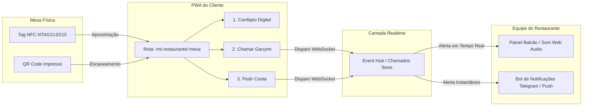

# 🏛️ Arquitetura do Sistema — Call-in

## 1. Visão Geral
O **Call-in** é estruturado sobre o princípio de **Fricção Zero para o Cliente** e **Operação Conectada para o Restaurante**:

---

## 2. Componentes Principais

### 2.1. PWA do Cliente (`/m/:restauranteId/:mesaId`)
- **Abertura:** Invocada diretamente pelo link NDEF gravado na tag NFC (ex: `https://callin.app/m/pizzaria-roma/04`).
- **Estado Local:** Mantém debounce de 30s para evitar cliques múltiplos acidentais no botão de chamado.
- **Feedback:** Dispara `navigator.vibrate(200)` para confirmação sensorial tátil imediata no smartphone do cliente.

### 2.2. Hub de Chamados em Tempo Real
- Registra cada chamado com: `id`, `restauranteId`, `mesaId`, `tipo` (`garcom_mesa` | `gelo_talher_guardanapo` | `pedir_conta`), `metodoPagamento` (se aplicável), `timestamp` e `status` (`pendente` | `atendido`).

### 2.3. Painel do Salão / Balcão (`/painel/:restauranteId`)
- Exibe o grid de mesas ativas.
- Emite sinal sonoro suave sintetizado via Web Audio API.
- Permite que o atendente marque o chamado como "Atendido" em 1 toque.

---

## 3. Fluxo de Gravação do Hardware Físico
1. **Ferramenta:** Aplicativo gratuito **NFC Tools** no iPhone / Android.
2. **Procedimento:**
   - Abrir a aba `Escrever` > `Adicionar um registro` > `URL / URI`.
   - Inserir a URL canônica da mesa (ex: `https://callin.app/m/[restaurante]/[mesa]`).
   - Aproximar a parte superior do iPhone da placa/chip NFC para gravação.
   - Opcional: Proteger a tag contra regravação com senha.
