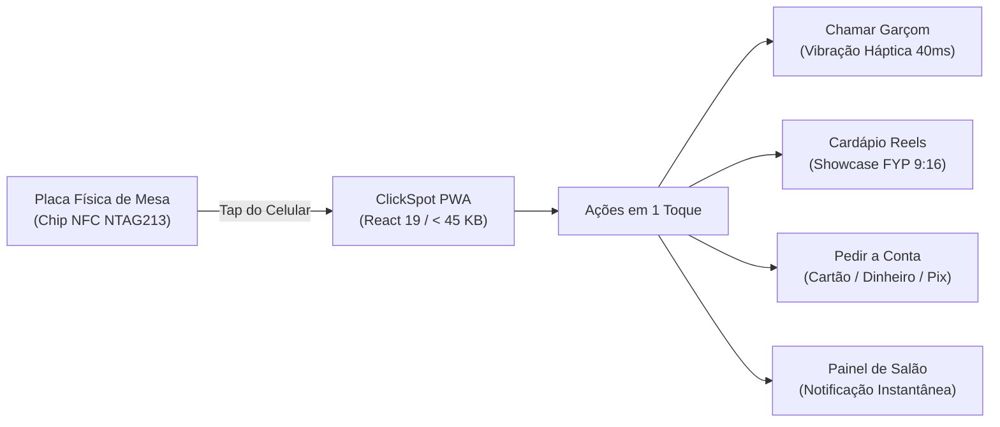

# 🛎️ CLICKSPOT: SHOWCASE GITHUB & STORYTELLING LINKEDIN

---

## 🐙 PARTE 1: README.MD DE VITRINE INTERNACIONAL

```markdown
# 🛎️ ClickSpot — Atendimento Inteligente de Mesas com NFC & PWA Ultraleve

[](https://react.dev)
[](https://www.typescriptlang.org)
[](https://vitejs.dev)
[](https://vitest.dev)
[]()
[]()
[](LICENSE)

> **Encostou. Chamou. Pediu.**  
> Solução integrada de hardware físico (NFC NTAG213/215 + QR Code) e software ultraleve (< 45 KB) para atendimento instantâneo em restaurantes, bares e cafeterias, sem downloads de lojas ou cadastros.

---

## ⚡ Quickstart

```bash
# 1. Clonar o repositório
git clone https://github.com/kazuhirokamim/clickspot.git
cd clickspot

# 2. Instalar dependências
npm install

# 3. Rodar suíte de testes (30 testes TDD verdes)
npm test

# 4. Iniciar servidor de desenvolvimento
npm run dev
```

Acesse em seu navegador móvel em `http://localhost:5173`.

---

## 🏛️ Fluxo Operacional Ciberfísico



---

## 🚀 Diferenciais de Engenharia

- **Zero Instalação & Zero Cadastro:** O cliente não baixa aplicativos da App Store/Google Play nem cria senhas. A URL é disparada instantaneamente via chip NFC.
- **Showcase FYP 9:16:** Feed vertical de vídeos curtos dos pratos para elevar o ticket médio e o apetite do consumidor.
- **Feedback Háptico Imediato:** Confirmação de chamada de mesa via `navigator.vibrate` com fallback inteligente para dispositivos sem suporte.
- **Privacy by Design:** Nenhum dado pessoal do cliente é coletado ou armazenado (100% LGPD compliant).
- **Test-First Rigor:** 30 testes unitários automatizados com Vitest cobrindo fluxos de chamada, navegação de mídia e multi-inquilino.
```

---

## 💼 PARTE 2: ESTUDO DE CASO PARA O LINKEDIN (AUTORIDADE TÉCNICA)

```markdown
Por que restaurantes ainda gastam fortunas com tablets proprietários em cada mesa quando todo cliente carrega um supercomputador no bolso?

Ao analisar a experiência de consumo em restaurantes e cafeterias, um número sempre chama a atenção: soluções que exigem download de aplicativo nas lojas oficiais possuem mais de 78% de taxa de abandono no primeiro contato. O cliente quer atendimento imediato, não mais um login e senha na memória do celular.

Construí o ClickSpot para solucionar exatamente essa fricção.

A proposta de engenharia:
1. 📡 Hardware de Custo Residual: Etiquetas físicas com chips NFC NTAG213 (13.56 MHz) nas mesas que disparam a sessão em milissegundos sem bateria ou fiação.
2. ⚡ PWA Ultraleve em React 19 & Vite 6: Um bundle de menos de 45 KB que carrega em menos de 400ms mesmo em redes móveis 4G instáveis.
3. 📳 Feedback Multimodal Háptico: Acionamento imediato de garçom ou conta com resposta física via Vibration API no smartphone e alerta em tempo real no balcão.
4. 🔒 Privacy by Design (LGPD): Zero retenção de PII. Ninguém precisa dar e-mail ou CPF para chamar o garçom.

O projeto foi construído sob estrita disciplina de TDD com 30 testes automatizados no Vitest e arquitetura limpa.

O repositório completo e o artigo técnico estão públicos no meu GitHub:
👉 https://github.com/kazuhirokamim/clickspot

Como a computação ubíqua e os PWAs têm impactado as operações no seu segmento? Vamos debater nos comentários! 👇

#SoftwareEngineering #WebDevelopment #React19 #TypeScript #NFC #PWA #CleanArchitecture #TechLeadership
```
